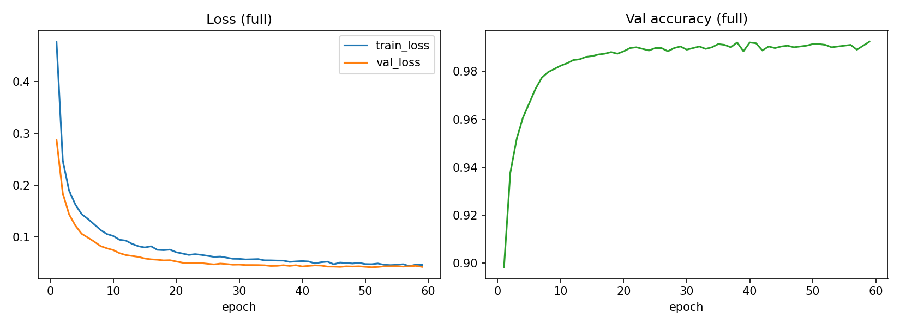
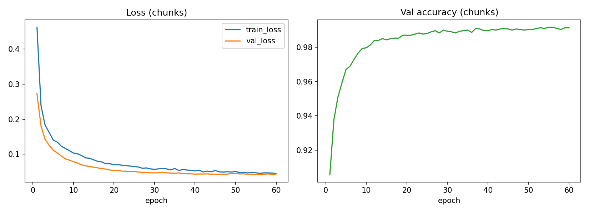

# ЛР3. Пайплайн DL-модели: полный датасет и чанки

| Поле | Значение |
|---|---|
| Номер варианта | 10 (Шумовые признаки, профиль P1 - табличный) |
| Номер работы | ЛР3 |
| Дата | 2026-10-25 |
| Автор | Нефедова А.А. |
| Хеш коммита кода | 2b94627a3cda742e6f1f764200bc0ce02170aea4 |
| Хеши данных | data/raw/dataset.csv sha256=6a0f0cf7c9c9b642638803e9b8db0a0fb67376d362777a756222820703ae4697 |

## 1. Схема настроек (pydantic, configs/dl_config.yaml)

Поля схемы DLConfig: dataset_path, hash_manifest_path, lab2_metrics_path,
report_dir, checkpoint_path, seed=511, val_size=0.15,
test_size=0.15, hidden_dims=[128, 64], dropout=0.2,
lr=0.001, batch_size=256, max_epochs=60,
patience=8, chunk_size=2000,
n_bootstrap=1000, mode_tolerance=0.01,
device=auto, deterministic=True,
num_threads=1.
Валидаторы отвергают: несуществующие файлы, lr <= 0, dropout вне [0; 1),
пустую или неположительную архитектуру, batch_size/chunk_size/max_epochs/
patience < 1, неизвестное device; отказы записаны в config_negative_test.log.

## 2. Архитектура и условия обучения

Модель профиля P1 (табличный): MLP 20 -> 128 -> 64 -> 1, активация ReLU,
Dropout(0.2), выход - один логит, потеря BCEWithLogitsLoss.
Число параметров: 11009.
Оптимизатор Adam(lr=0.001), батч 256, не более 60 эпох.
Ранняя остановка: 8 эпох без улучшения val_loss, лучшие веса
восстанавливаются (full: эпоха 51 из 59,
chunks: эпоха 59 из 60).
Стандартизация: статистики StandardScaler накоплены partial_fit по чанкам
train+val и общие для обоих режимов; test в фите скейлера не участвует.
Устройство: cuda. Детерминированные алгоритмы torch:
True, потоков CPU: 1.
Объявленный режим совпадения прогонов: ТОЧНО (фиксированное зерно 511 +
детерминированные алгоритмы + один поток CPU) - два прогона дают идентичные
метрики до 6 знака включительно (dl_run1.log, dl_run2.log).

## 3. Источники данных

- full: весь датасет читается в память, TensorDataset + DataLoader с shuffle
  (генератор перемешивания инициализирован зерном 511).
- chunks: потоковый IterableDataset (CsvStreamDataset) читает csv чанками по
  2000 строк и отдаёт батчи по 256; датасет целиком не
  материализуется - в память заранее читается только колонка target для
  стратифицированного сплита. Порядок строк потока фиксирован (детерминизм).
- Профиль P1: датасет помещается в память, поэтому полный режим без стриминга
  допустим (для P3/P4 стриминг был бы обязателен и в полном режиме).

## 4. Кривые потерь и метрик

- full: [dl_curves_full.csv](dl_curves_full.csv), график 
- chunks: [dl_curves_chunks.csv](dl_curves_chunks.csv), график 
- full: лучший val_loss = 0.041517 на эпохе 51,
  остановка на эпохе 59.
- chunks: лучший val_loss = 0.041404 на эпохе 59,
  остановка на эпохе 60.

## 5. Сравнение режимов

| Метрика | full | full 95% ИИ | chunks | chunks 95% ИИ | full-chunks |
|---|---|---|---|---|---|
| accuracy | 0.989000 | [0.985333; 0.992667] | 0.991000 | [0.987667; 0.994333] | 0.002000 |
| pr_auc | 0.991243 | [0.984312; 0.996746] | 0.992507 | [0.986833; 0.997091] | 0.001265 |
| roc_auc | 0.994114 | [0.990724; 0.997178] | 0.994679 | [0.991547; 0.997505] | 0.000565 |

Интервалы метрик - бутстрэп 2.5%/97.5% по 1000 пересборкам теста.
Вердикт по accuracy: расхождение 0.0020 не превышает допуск 0.01: режимы сошлись.
Номера прогонов MLflow (эксперимент lab3-variant10):
full = 3569afd88df74d149ced64b45e879b0c,
chunks = 029b7b76da7f418d8b1763b294c74834.

Память и время (memory_compare.csv), пик - tracemalloc вокруг загрузки данных
и обучения, время - весь режим:

| Режим | Пик памяти, МБ | Время, с | Эпох |
|---|---|---|---|
| full | 11.1172 | 29.6238 | 59 |
| chunks | 2.7151 | 36.3652 | 60 |

Пик стриминга ограничен чанком и батчем и не растёт с объёмом данных
(тест tests/test_lab3_stream.py: 4000 против 8000 строк, stream_tests.log).

## 6. Сравнение с ML-моделью ЛР2

| Метрика | ML ЛР2 (full) | DL ЛР3 (full) | DL - ML |
|---|---|---|---|
| accuracy | 0.798000 | 0.989000 | +0.191000 |
| pr_auc | 0.864095 | 0.991243 | +0.127148 |
| roc_auc | 0.874766 | 0.994114 | +0.119348 |

Числа ML взяты из reports/LAB2/ml_metrics.csv (режим full). Итог: DL-модель выше ML-модели ЛР2 на 0.191000 по accuracy.

## 7. Воспроизводимость и паритет устройств

| Проверка | Результат | Файл |
|---|---|---|
| Два прогона с тем же зерном | метрики совпадают точно (режим ТОЧНО) | dl_run1.log, dl_run2.log |
| Повтор обучения и загрузки чекпоинта | сверка с dl_metrics.csv, --check-repeat | repeat_check.log |
| Снятая фиксация зерна | прогоны расходятся - фиксация необходима | seed_control.log |
| Паритет CPU/ускоритель, допуск 1e-5 | max разница 1.19e-07, паритет CPU/CUDA подтверждён | dl_run1.log |

## 8. Чекпоинт

- Файл: reports/LAB3/dl_model.pt, sha256=3cb6279e815e5e7b4f4b7d1ceb9a3c246d2fc08874842f335d2d7a60082f95b5.
- Состав: state_dict весов, статистики скейлера (mean/scale), метаданные
  (архитектура, dropout, зерно, эпохи, число параметров).
- Загрузка и предсказание воспроизводятся: --check-repeat сравнивает
  предсказания загруженного чекпоинта с dl_metrics.csv (repeat_check.log).

## 9. Негативные контроли

| Контроль | Чем проверяли | Результат | Файл |
|---|---|---|---|
| Невалидный конфиг: lr <= 0 | запуск с configs/negative/bad_lr.yaml | отказ с объяснением, exit 2 | config_negative_test.log |
| Невалидный конфиг: dropout вне [0; 1) | запуск с configs/negative/bad_dropout.yaml | отказ с объяснением, exit 2 | config_negative_test.log |
| Невалидный конфиг: файл данных не существует | запуск с configs/negative/bad_path_dl.yaml | отказ с объяснением, exit 2 | config_negative_test.log |
| Снятая фиксация зерна | --seed-control: два обучения без manual_seed | val_loss и val_accuracy прогонов расходятся | seed_control.log |
| Стриминг держит память ограниченной | pytest: пик загрузчика на 4000 и 8000 строк | прирост пика меньше двух чанков | stream_tests.log |

## 10. Выводы

1. MLP 20 -> 128 -> 64 -> 1 содержит 11009 параметров; ранняя
   остановка сработала на эпохе 59 (full) и
   60 (chunks), лучшие веса восстановлены
   (dl_curves_full.csv, dl_curves_chunks.csv).
2. Полный режим: accuracy = 0.989000 с 95% интервалом
   [0.985333; 0.992667]
   (dl_metrics.csv: full accuracy).
3. Потоковый режим: accuracy = 0.991000 с 95% интервалом
   [0.987667; 0.994333]
   (dl_metrics.csv: chunks accuracy).
4. Разность accuracy режимов 0.002000; вердикт: расхождение 0.0020 не превышает допуск 0.01: режимы сошлись (dl_metrics.csv).
5. DL-модель выше ML-модели ЛР2 на 0.191000 по accuracy (раздел 6; числа ЛР2 из ml_metrics.csv).
6. Пик памяти: full 11.1172 МБ против chunks 2.7151 МБ;
   стриминг ограничен порцией и не растёт с объёмом данных
   (memory_compare.csv, stream_tests.log).
7. Время обучения: full 29.6238 c, chunks 36.3652 c
   (memory_compare.csv).
8. Воспроизводимость подтверждена записями: два прогона совпали точно
   (dl_run1.log, dl_run2.log), --check-repeat совпал с csv и чекпоинтом
   (repeat_check.log); без фиксации зерна прогоны расходятся (seed_control.log).
9. Паритет устройств: max разница предсказаний 1.19e-07 <= 1e-5,
   паритет CPU/CUDA подтверждён (раздел 7).
10. Чекпоинт reports/LAB3/dl_model.pt sha256=3cb6279e815e5e7b... загружается
    и воспроизводит предсказания (раздел 8, repeat_check.log).
